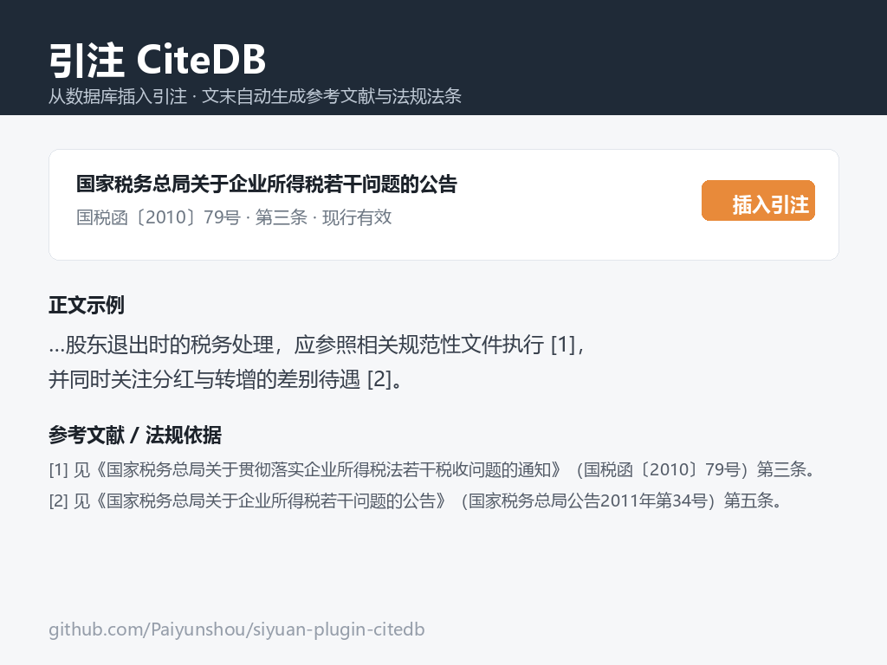
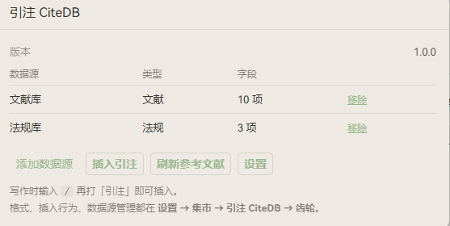
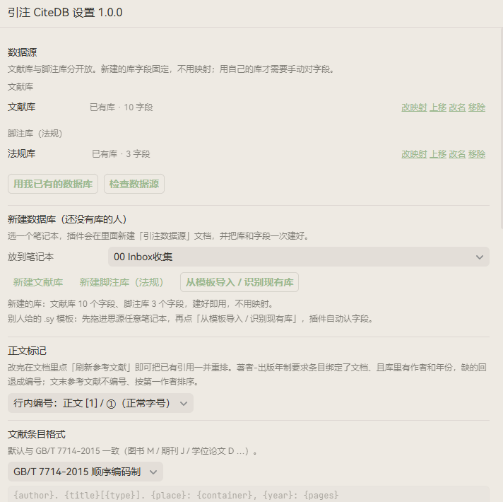
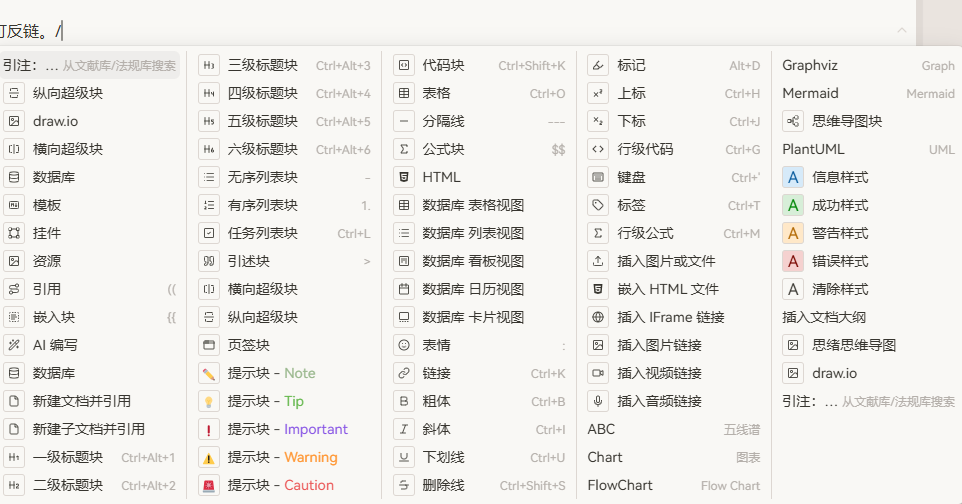
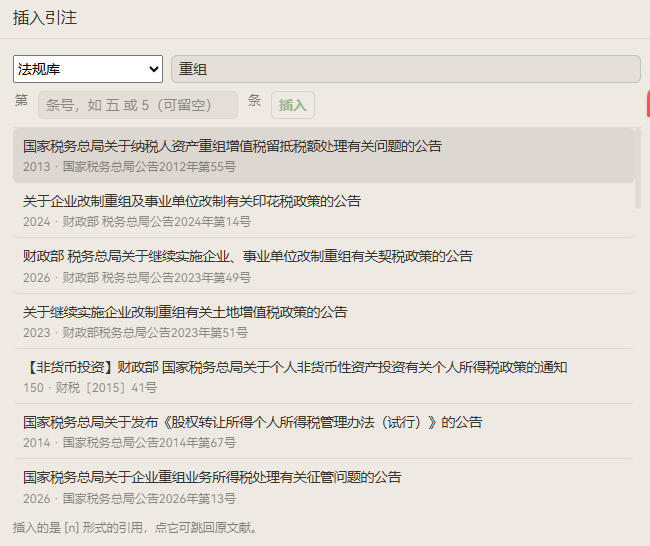

# CiteDB for SiYuan

> Insert `[1]` / `①` citations from **your own SiYuan databases** while writing, and get a bibliography and statute list generated at the end of the document.

A lightweight citation workflow for tax, legal and research writing. No Zotero-grade machinery — just clean in-text markers, clickable sources, and a bibliography that builds itself.



## What it does

- **Sources come from databases**: paper and statute libraries are ordinary SiYuan attribute views; no re-typing
- **Type `/` and insert**: search by keyword, press Enter, get `[1]`; the same source reuses its number
- **Bibliography builds itself**: statutes go into 注 (①②…), papers into 参考文献 ([1][2]…), updated after every insert or on demand
- **Citations are block refs**: when an entry is linked to a document, `[1]` jumps back to it and backlinks show which documents cite it
- **Three marker styles**: superscript `[1]`/`①`, inline `[1]`/`①`, or author-year `（贾宁，2020：45）` — switch any time, no entries lost



## Install

- From the marketplace: Settings → Marketplace → search "引注" → install and enable
- Manually: copy this folder to `{workspace}/data/plugins/siyuan-plugin-citedb/` and enable it under Marketplace → Downloaded

Requires SiYuan 3.1.13 or later. A quotes button appears in the top bar; click it to open the insert panel.

## Quick start

### 1. Set up a data source

Settings → Marketplace → Downloaded → CiteDB → gear:

| Your situation | What to do |
| --- | --- |
| No library yet | Pick a notebook → "New paper library" / "New statute library"; the plugin creates the view with 10 / 3 typed columns |
| You already have one | "Use my own database" → pick the view → map fields; each field shows a real value from the first row and previews the citation text live |
| A `.sy` template from someone else | Drop it into any notebook → "Import from template / detect existing"; columns are matched by name |

Paper and statute libraries are configured separately, and you can have several of each. "Move up" controls search order; "Check data sources" reports missing or empty views.



### 2. Insert a citation

Type `/` in the editor → "引注" → type a keyword → Enter.

- Statutes: put an article number like `五` in the "article" box → `（财税〔2009〕59 号）第五条`
- Books / journals: page numbers are supported and carried into author-year citations





### 3. End-of-document lists

After each insert, two blocks are created or refreshed at the end of the document:

```
注
① 《财政部 国家税务总局关于企业重组业务企业所得税处理若干问题的通知》（财税〔2009〕59 号）第五条。
② ……

参考文献
[1] 贾宁. 一本书看透股权架构[M]. 北京: 机械工业出版社, 2020: 45.
[2] ……
```

Headings are configurable; auto-refresh can be turned off in favour of the "Refresh bibliography" command.

## Marker styles

| Style | In text | End of document |
| --- | --- | --- |
| Superscript (default) | ᵗ[1], ᵗ① | numbered [1][2]…, ①②… |
| Inline | [1], ① (normal size) | same |
| Author-year | （贾宁，2020：45） | no numbers, sorted by first author's pinyin |

Author-year requires an author column and only applies when every entry has one; otherwise the plugin reports how many are missing and keeps numbering. Entries not linked to a document become plain text labels in author-year mode (e.g. 「（樊勇 等，2026）」) and go back to `[n]` when you switch styles again.

## Settings

- **Marker style**: superscript / inline / author-year
- **Paper format**: GB/T 7714-2015 numeric, or a custom template
- **Statute format**: 《name》(number) art. N / 《name》 art. N / custom template
- **Authors**: how many to show, whether to append 「等」
- **Trailing period** on entries
- **Headings** for the reference / statute blocks
- **Auto-refresh** the bibliography after inserting
- **Link entry titles** back to their documents
- **Config backup**: export / import JSON (sources and formatting only, never note content)

## Where the data lives

- Citation lists live in document attributes `custom-citedb-refs`, `custom-citedb-notes` and `custom-citedb-bib`, so they sync with the document and survive uninstalling the plugin
- Plugin config lives in `data/storage/petal/siyuan-plugin-citedb/citedb.json` — sources and formatting only
- Field mappings are stored by column **ID**, so renaming a column never breaks them

## FAQ

**Why link entries to documents?**
Only linked entries become block refs: clicking the number jumps to the source, and backlinks reveal which documents cite it. Unlinked entries still work, as plain numbers.

**Can I cite a specific paragraph of a statute?**
Only down to the article. Paragraph / item numbers are typed by hand because statute layouts differ too much to infer.

**What about switching machines?**
Libraries sync with their notebook and citation lists sync with documents; re-bind the library with "Import from template / detect existing", or carry the config JSON.

**Does it work in the browser / Docker edition?**
Yes — kernel API only, no Electron dependencies.

## Development

```bash
npm run check                  # syntax check + 40 unit tests
python3 tools/deploy.py        # deploy into a local SiYuan (reads SIYUAN_URL / SIYUAN_TOKEN)
node tools/test-live-style.js  # round-trip the three marker styles against a live instance
```

`index.js` is the whole implementation (plain CommonJS, no build step); `index.css` holds styles, `i18n/` the strings, `tools/` the deploy and test scripts.

## License

MIT
