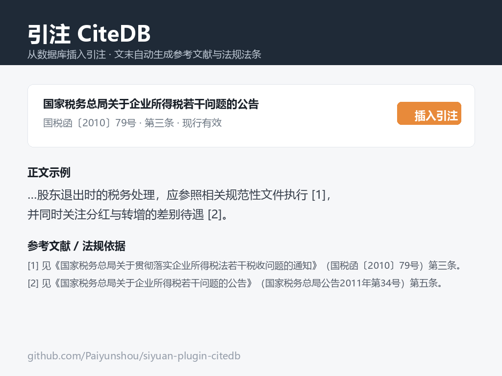

# 引注 CiteDB

> 在思源笔记里写文章时，从你自己的数据库（属性视图）插入引注 `[n]`，文末自动生成参考文献与法规法条。

面向财税从业者的**轻量**方案：不做学术级的 Zotero 流程，只要「看起来专业、有出处」。

## 当前状态

`0.1.0` — **骨架版**：插件可安装、顶栏有入口、面板可打开、能显示数据源配置状态。
引注插入（L1）尚未实现，面板上的按钮是禁用状态。

## 为什么做这个

常见的做法是 Zotero + Word：抓取用 Zotero、写作在 Word，两头配置复杂，普通人配一次要折腾半天。
如果资料来源大多是书籍、期刊和法规，而这些已经在思源里用数据库管起来了，那完全可以在思源里一步完成：

1. 引用从数据库来（不用重复录入）
2. 正文里只出现干净的 `[1]`
3. 文末自动列出「被引文献 / 法规依据」
4. 引用即双链，反链面板能看到「这篇文献被哪些文章引用过」

## 设计

- **数据源 = 属性视图（数据库）**，不新造数据格式
- **只认三样东西**：库 + 字段映射 + 引文模板。加一个库就是加一条配置，不改代码
- **字段映射按列 ID 存**，不按列名，改列名不会断
- **引用清单存在文档属性里**（`custom-cite-refs`），跟着文档同步，卸载插件不丢
- **字段缺失就不显示**：没有年份，引文里那一截直接省略，不留空括号
- **网页版可用**：只调内核 API，Docker / 浏览器端无需 Electron

## 引文模板（默认）

| 类型 | 模板 |
| --- | --- |
| 图书 | `见 作者：《题名》，出版社，年。` |
| 期刊 | `见 作者：《题名》，《刊名》，年(期)：页码。` |
| 法规 | `见《法规标题》（文号）第X条。` |

## 安装（开发期）

插件未上架集市。手动安装：

1. 下载本仓库，把整个文件夹放到工作空间 `data/plugins/siyuan-plugin-citedb/`
2. 思源里打开「集市 → 已下载」，找到 **引注 CiteDB** 启用
3. 顶栏出现橙色引号图标，点击打开面板

## 路线图

- [x] 0.1.0 骨架：顶栏入口、面板、配置存储
- [ ] L1 插入引注：多数据源配置、搜索面板、插入 `[n]`、法规条号定位、文末列表、手动刷新
- [ ] L2 自动重排、同源去重
- [ ] L3 导出前静态化、配置分享

## 许可

MIT
