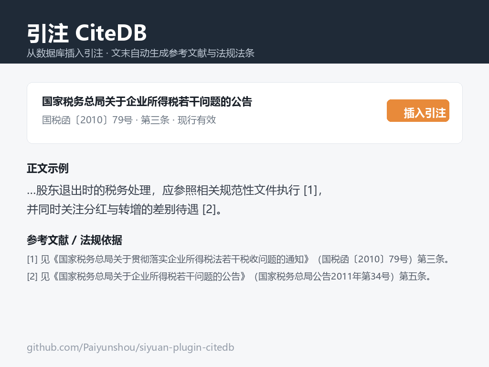
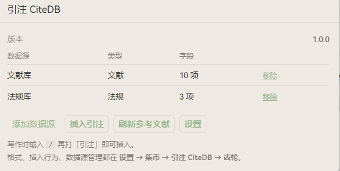
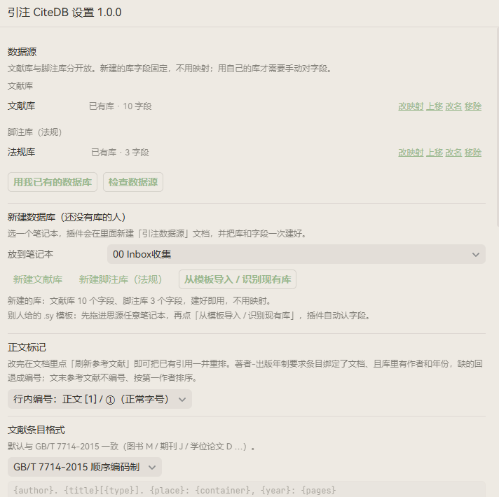
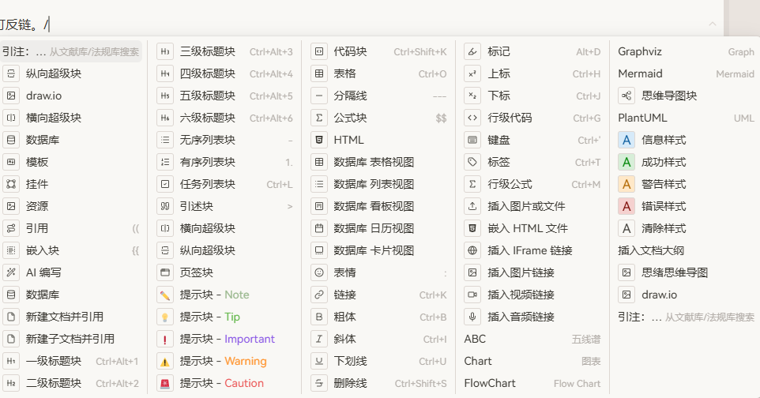

# 引注 CiteDB

> 在思源里写文章，从**你自己的数据库**插入引注 `[1]` / `①`，文末自动生成参考文献与法规依据。

面向财税、法律、研究写作的轻量方案：不做 Zotero 那种学术级流程，只要「正文干净、出处可点、文末成表」。



## 它能做什么

- **引用来自数据库**：文献库、法规库都是普通的思源属性视图（数据库），不用重复录入
- **一处配置、随处插入**：正文输入 `/` 搜关键词，回车即插 `[1]`，同一条文献重复引用自动复用编号
- **文末自动成表**：法规进「注」（①②），文献进「参考文献」（[1][2]…），插入后实时更新，也可手动「刷新参考文献」
- **引用即双链**：条目绑定了文档时，`[1]` 是可点的块引用，点数字跳回原文献；反链面板能看到「这篇文献被哪些文章引用过」
- **三种正文标记**：上标编号 `[1]`/`①`、行内编号 `[1]`/`①`、著者-出版年 `（贾宁，2020：45）`，随时切换，切回不丢条目



## 安装

- 已上架思源集市：设置 → 集市 → 搜索「引注」→ 安装并启用
- 手动安装：把本仓库放进工作空间 `data/plugins/siyuan-plugin-citedb/`，在「集市 → 已下载」里启用

启用后顶栏出现引号图标，点开就是插入面板。要求思源 3.1.13 及以上。

## 三分钟上手

### 1. 准备数据源

设置 → 集市 → 已下载 → 引注 CiteDB → 齿轮，按情况选一种：

| 你的情况 | 怎么做 |
| --- | --- |
| 还没有库 | 选一个笔记本 → 「新建文献库」/「新建脚注库（法规）」，插件把库和 10 个 / 3 个字段一次建好 |
| 已有自己的库 | 「用我已有的数据库」→ 选库 → 手动对字段，右侧显示库里第一行的真实值，底部实时预览引注文字 |
| 别人给的模板（.sy） | 拖进思源任意笔记本 → 「从模板导入 / 识别现有库」，按列名自动认出文献库 / 法规库 |

文献库与法规库分开管理，同类可以有多个（例如「中文专著」「税务期刊」）。「上移」决定搜索结果里谁排前面，「检查数据源」一次报出失效的、空的库。



### 2. 插入引用

正文输入 `/` → 打「引注」→ 输关键词 → 回车。

- 引用法规：在「条号」里填 `五`，生成「（财税〔2009〕59 号）第五条」
- 引用图书 / 期刊：可填页码，著者-年制下会带进引注




### 3. 文末列表

每次插入后在文末自动生成 / 更新两个区块：

```
注
① 《财政部 国家税务总局关于企业重组业务企业所得税处理若干问题的通知》（财税〔2009〕59 号）第五条。
② ……

参考文献
[1] 贾宁. 一本书看透股权架构[M]. 北京: 机械工业出版社, 2020: 45.
[2] ……
```

文末按设置里的「文末标题」定名，可关掉自动更新、改用命令面板的「刷新参考文献」。

## 正文标记

| 样式 | 正文效果 | 文末 |
| --- | --- | --- |
| 上标编号（默认） | ᵗ[1]、ᵗ① | 参考文献 [1][2]…；法规注 ①②… |
| 行内编号 | [1]、①（正常字号） | 同上 |
| 著者-出版年 | （贾宁，2020：45） | 不编号，按第一作者拼音排序 |

著者-年制需要文献库里有「作者」列；缺作者的条目只有在**全部条目都填了作者**时才切得过去，否则提示缺几条、仍按编号排。没绑定文档的条目在著者-年制下是纯文字标签（如「（樊勇 等，2026）」），切回编号照常恢复。

## 设置项一览

- **正文标记**：上标编号 / 行内编号 / 著者-出版年
- **文献格式**：GB/T 7714-2015 顺序编码制，或自定义模板
- **法规格式**：《法规名》（文号）第X条 /《法规名》第X条 / 自定义模板
- **作者**：最多显示几人、超出是否加「等」
- **条目结尾加句号**：法规条目默认不加
- **文末标题**：参考文献 / 法规依据 / 注释，可自定
- **自动更新文末**：插入后是否立刻重排
- **条目标题带双链**：文末条目是否链回原文档
- **配置备份**：导出 / 导入 JSON（只含数据源与格式设置，不含任何笔记内容）

## 数据放在哪

- 引用清单存在文档属性 `custom-citedb-refs`、注释清单在 `custom-citedb-notes`、参考表位置在 `custom-citedb-bib`，跟着文档同步，**卸载插件不丢**
- 插件配置在 `data/storage/petal/siyuan-plugin-citedb/citedb.json`，只存数据源与格式，不存笔记正文
- 字段映射按**列 ID** 存，改列名不会断

## 常见问题

**为什么要「绑定文档」？**
绑定后引用才是块引用，点数字能跳回原文，反链里能查到引用关系。库里没有对应文档的条目也能引，只是退化成纯编号。

**能引一条法规里的某几款吗？**
目前只到「条」，款 / 项手填在条目里——不同法规的编法差别太大，先不自动推。

**换电脑怎么办？**
库跟着笔记本同步，引用清单跟着文档同步；换机器后用「从模板导入 / 识别现有库」重新挂一次库即可，或用「配置备份」导出 JSON 带走。

**网页版 / Docker 能用吗？**
能。插件只调内核 API，不依赖 Electron。

## 开发

```bash
npm run check              # 语法检查 + 单元测试（40 项）
python3 tools/deploy.py    # 部署到本地思源（读 /opt/data/.env 的 SIYUAN_URL/SIYUAN_TOKEN）
node tools/test-live-style.js  # 真实思源里跑三种标记样式的来回切换
```

目录：`index.js` 是全部实现（无构建链，思源自定义 CommonJS），`index.css` 样式，`i18n/` 文案，`tools/` 部署与测试脚本。

## 许可

MIT
